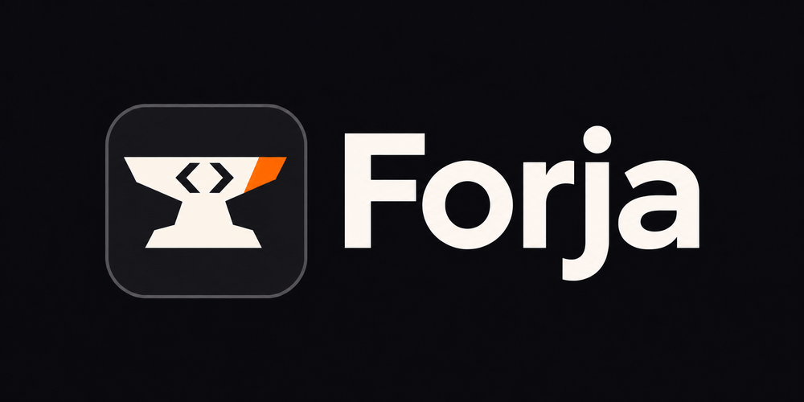
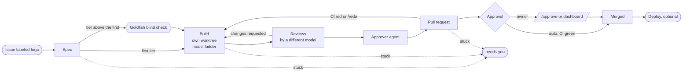
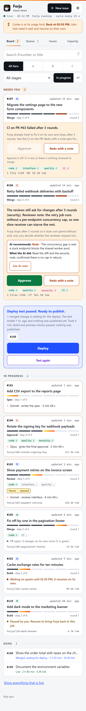

<p align="center">
  
</p>

<p align="center">
  A software factory for your GitHub repository, as a Claude Code plugin.<br>
  Label an issue. Get a reviewed pull request. You stay in control of the merge.
</p>

<p align="center">
  <a href="LICENSE"></a>
  <a href="https://github.com/jvitorbarros15/forja/actions/workflows/test.yml"></a>
  
  
  
</p>

## Why Forja

You label an issue, and Forja writes a spec, builds the change in its own git worktree, has a different model review it, opens a pull request, waits for your approval, and merges it. You watch and approve from the dashboard or from PR comments.

- **Risk decides the process.** Each issue is sorted into a tier. The tier decides which reviews run and who must approve.
- **A different model reviews the code.** Reviews prefer a different vendor from the builder, so one model does not grade its own work.
- **You approve by default.** Auto merge is opt-in, limited to paths you list, and never applies to protected files.
- **Your working copy is never touched.** Forja works only in its own worktrees.
- **Small and portable.** A Node 22 engine with no npm dependencies, on Windows, macOS and Linux. It works with Claude alone, and other vendors are optional.

## Quick start

In Claude Code, inside any git repository with a GitHub remote:

```
/plugin marketplace add jvitorbarros15/forja
/plugin install forja@forja
/forja:setup
```

`/forja:setup` detects what is installed, asks before turning on optional vendors, and writes `.forja/config.json`. Commit that file and merge it to your default branch, then start the engine. The runner reads its config only from the merged branch: `/forja:start` refuses to run, and `/forja:doctor` warns, until `.forja/config.json` is on the default branch.

```
/forja:start
```

`/forja:doctor` checks the setup. `/forja:status` and `/forja:stop` show and stop the running engine.

### Requirements

Required:

- Node.js 22 or newer
- git
- GitHub CLI (`gh`), authenticated with `gh auth login`
- Claude Code with the `claude` CLI on your PATH

Optional:

- `codex` or `gemini` CLIs, for reviews and builds by other vendors. `agy` (Antigravity CLI, Gemini models) is an option used by the Clareia example only
- Ollama, for local triage
- Playwright with Chromium, for UI screenshots and the `ui` review

Vendors are off until you enable them in `.forja/config.json`. Forja works with Claude alone.

Model chains are lists like `["claude:sonnet", "codex:sol"]`. The builder and the reviewers accept any enabled vendor; goldfish requires an enabled non-Claude vendor (it is skipped in a Claude-only setup). The spec, approver and advisor roles must be `claude:*` entries: they run as restricted Claude agents with tool allowlists (they read files and may run only a short list of commands, with no network), and no other vendor's CLI can enforce that.

## How it works



Each issue is sorted into a risk tier first. The tier decides which reviews run and who must approve. A tier with `approval: "auto"` merges itself once CI is green, except when the diff touches a protected path (see the safety model), which always waits for you; other tiers wait for your approval. A tier can also limit which paths a change may touch.

"redo" loops back to build, up to `limits.rounds` rounds. Stuck jobs go to `needs-you` and wait for you.

### Tiers and reviews

These are the defaults. Every tier, review and approval rule can be changed in `.forja/config.json`.

| Tier | Meant for | Reviews | Approval | Spec and approver models | Path limit |
| --- | --- | --- | --- | --- | --- |
| A | Only tests, docs, markdown or purely visual CSS; cannot change app behavior | `code` | owner | standard | `test/**`, `tests/**`, `docs/**`, `**/*.md`, `**/*.css` |
| B | App logic, UI behavior, copy or markup | `code`, `ui` (only when the builder reports UI changes), `ponytail` | owner | standard | none |
| C | Auth, secrets, payments, migrations or user data, deploy or CI config, or loosening any check | `code`, `ponytail`, `security` | owner | strong | none |

Reviews run in two passes. `code` and `ui` run first. `ponytail` and `security` are deferred reviews and start only after the first pass passes. When an external vendor is configured in `models.goldfish`, goldfish checks the spec of every tier above the first one (B and C by default); in a Claude-only setup it is skipped. Triage can raise a tier, never lower it. Tier C uses the strong spec and approver models (`models.specStrong`, `models.approverStrong`).

### Named reviewers

- **ponytail** is the code-quality review: is the logic right, is it safe, does it hold under real load, is risky code tested, and is every line needed.
- **goldfish** is a blind check of the spec before any code is built. An external (non-Claude) model configured in `models.goldfish` sees only the spec and the repo, not the issue thread, and tries to break the spec: missed cases, wrong files, criteria that cannot be checked. Without a non-Claude entry in `models.goldfish` (including the default Claude-only setup), goldfish is skipped.

## Dashboard

<table align="center">
  <tr>
    <td valign="top">
      <picture>
        <source media="(prefers-color-scheme: dark)" srcset="docs/screenshots/dashboard-1440-dark.png">
        
      </picture>
    </td>
    <td valign="top">
      <picture>
        <source media="(prefers-color-scheme: dark)" srcset="docs/screenshots/dashboard-390-dark.png">
        
      </picture>
    </td>
  </tr>
</table>

The local dashboard shows each job, the stage it is in, its reviews and the buttons to approve, redo or deploy. It works on a desktop and on a phone.

## Safety model

- **Owner approval by default.** Every tier starts with `approval: "owner"`. A person in `approvers` must approve each change, and only logins in that list can label issues or run `/approve` and `/redo`.
- **Auto approval is opt-in and path-bound.** `approval: "auto"` or `autoDeploy: true` is accepted only on a tier that lists `paths`. A build that touches a file outside those paths fails.
- **Protected paths.** `.forja/**`, `.github/workflows/**` and `.claude/**` cannot be edited by the builder. Any diff that touches them needs owner approval, whatever its tier.
- **Check commands run code the builder wrote.** `checks.install`, `typecheck`, `test` and `build`, the allowed test commands of the agents and `ui.serve` and `ui.verify` all run in a job's worktree with your user rights, your environment and your `gh` token, and they execute what the builder just wrote (tests, scripts, install hooks). Forja cannot sandbox that. Run it in a VM, a container or a separate OS account, and give `gh` a token scoped to this one repository (a fine-grained token with only contents, pull requests and issues).
- **Your working copy is never touched.** Forja works only in its own worktrees, `<worktreeRoot>/forja-main` and `<worktreeRoot>/forja-<issue>`.
- **Merged config only.** Forja reads `.forja/config.json` and agent overrides from the merged `forja-main` worktree. A change takes effect after you merge it, never from an open branch. `forja-main` is Forja's own: before every fast-forward and every runner cycle (except while a deploy runs) anything changed or left in it is discarded (`git reset --hard`, `git clean -fd`, `node_modules` kept), so keep no work there.
- **Privacy rules.** `privacy.denyRead` is enforced for Claude agents as a read-deny rule. External vendors cannot be restricted that way, so the same patterns are stated in their prompts. `privacy.promptRules` are added to every agent prompt as hard rules.
- **Review by a different model.** Reviews prefer a different vendor from the builder, so one model does not grade its own work.

## Configuration

Everything project-specific lives in `.forja/config.json`: repository, approvers, check commands, tiers, review matrix, model chains, vendors, privacy rules, commit style and language. The smallest working file needs two keys, and everything else comes from the defaults:

```json
{
  "repo": "your-login/your-repo",
  "approvers": ["your-login"]
}
```

Two starting points are in [`examples/`](examples/):

- [`examples/minimal.config.json`](examples/minimal.config.json): repository and approvers only.
- [`examples/clareia.config.json`](examples/clareia.config.json): a full real-world setup with three tiers, custom checks, a custom data reviewer and privacy rules.

The Clareia example is a real-world config, not a template. It expects `.forja/agents/review-data.md` in the repo, and it uses `{project}` in check commands for data kept outside git (the `data/private` folders are never in a worktree).

Useful defaults, all overridable:

| Key | Default |
| --- | --- |
| `defaultBranch` | `main` |
| `intakeLabel` | `forja` |
| `pr.mergeMethod` | `squash` |
| `pr.requireCi` | `false` |
| `queue.max` | `3` |
| `limits.rounds` | `3` |
| `server` | `127.0.0.1:4317` |

The skill that documents every key, with examples for tiers, chains, reviewers, overrides and checks, is [`skills/forja/SKILL.md`](skills/forja/SKILL.md).

## FAQ

**Does Forja need anything besides Claude?**
No. Other vendors (`codex`, `gemini`, `agy`, Ollama) are off until you enable them. Forja runs on Claude alone.

**Can it merge without me?**
Only on a tier you set to `approval: "auto"` that lists `paths`, once CI is green. A diff that touches `.forja/**`, `.github/workflows/**` or `.claude/**` always waits for you.

**What happens when CI fails or I ask for changes?**
The job goes back to build with the CI error or your note, up to `limits.rounds` rounds. After that it moves to `needs-you`. Comment `/redo` with a note on the PR, or use the dashboard.

**Will it touch my working copy?**
No. It works in its own worktrees, `<worktreeRoot>/forja-main` and `<worktreeRoot>/forja-<issue>`. Keep no work in `forja-main`.

**Who can start a job?**
Only logins listed in `approvers` can label issues or run `/approve` and `/redo`.

**Is it safe to run on my laptop?**
Check commands run code the builder wrote, with your user rights and your `gh` token. Use a VM, a container or a separate OS account, and a `gh` token scoped to one repository. See the safety model.

**Why is my config change ignored?**
The runner reads `.forja/config.json` only from the merged default branch. Merge it first. `/forja:doctor` warns until you do.

## Development

    npm test

Tests use `node:test` and need no install step.

## License

Forja is released under the [MIT License](LICENSE).

Bundled skills keep their own licenses. See [THIRD_PARTY.md](THIRD_PARTY.md).
