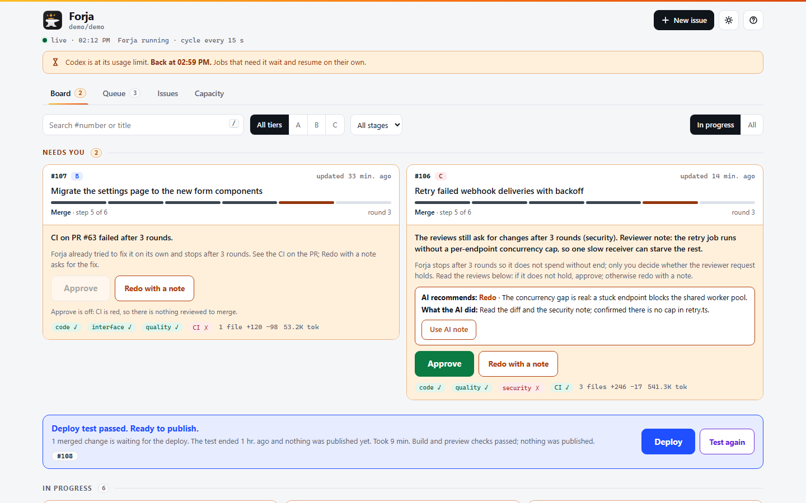

# Forja

Forja is a software factory for your GitHub repository. You label an issue, and Forja writes a spec, builds the change in its own git worktree, has a different model review it, waits for your approval, opens a pull request and merges it. You watch and approve from a local dashboard or from PR comments.

It runs as a Claude Code plugin with a small Node 22 engine and no npm dependencies.

## How it works

```
 issue labeled "forja"
        |
        v
  spec ------> build ------> review -------> approve ------> pr ------> merged ------> deployed
  (Claude)    (own worktree)  (code, ui, ponytail,  (owner click or    (opens a PR)  (optional
              tier-based      security, custom;      auto for tier A)                deploy step)
              model ladder)   a different model
                              than the builder)
        ^                          |
        +---- redo (max rounds) ---+        anything stuck --> needs-you (you decide)
```

Each issue is sorted into a risk tier first. The tier decides which reviews run and who must approve. A tier can also limit which paths a change may touch.

## Install

In Claude Code, inside any git repository with a GitHub remote:

```
/plugin marketplace add jvitorbarros15/forja
/plugin install forja@forja
/forja:setup
```

`/forja:setup` detects what is installed, asks before turning on optional vendors, and writes `.forja/config.json`. Commit that file and merge it to your main branch, then start the engine:

```
/forja:start
```

`/forja:doctor` checks the setup. `/forja:status` and `/forja:stop` show and stop the running engine.

Forja works on Windows, macOS and Linux.

## Requirements

Required:

- Node.js 22 or newer
- git
- GitHub CLI (`gh`), authenticated with `gh auth login`
- Claude Code with the `claude` CLI on your PATH

Optional:

- `codex`, `gemini` or `agy` CLIs, for reviews and builds by other vendors
- Ollama, for local triage
- Playwright with Chromium, for UI screenshots and the `ui` review

Vendors are off until you enable them in `.forja/config.json`. Forja works with Claude alone.

## Safety model

- **Owner approval by default.** Every tier starts with `approval: "owner"`. A person in `approvers` must approve each change, and only logins in that list can label issues or run `/approve` and `/redo`.
- **Auto approval is opt-in and path-bound.** `approval: "auto"` or `autoDeploy: true` is accepted only on a tier that lists `paths`. A build that touches a file outside those paths fails.
- **Protected paths.** `.forja/**`, `.github/workflows/**` and `.claude/**` cannot be edited by the builder. Any diff that touches them needs owner approval, whatever its tier.
- **Your working copy is never touched.** Forja works only in its own worktrees, `<worktreeRoot>/forja-main` and `<worktreeRoot>/forja-<issue>`.
- **Merged config only.** Forja reads `.forja/config.json` and agent overrides from the merged `forja-main` worktree. A change takes effect after you merge it, never from an open branch.
- **Privacy rules are enforced twice.** `privacy.denyRead` blocks agents from reading files such as `.env`, and `privacy.promptRules` are added to every agent prompt as hard rules.
- **Review by a different model.** Reviews prefer a different vendor from the builder, so one model does not grade its own work.

## Customization

Everything project-specific lives in `.forja/config.json`: repository, approvers, check commands, tiers, review matrix, model chains, vendors, privacy rules, commit style and language. Two starting points are in [`examples/`](examples/):

- [`examples/minimal.config.json`](examples/minimal.config.json): repository and approvers only. Everything else comes from the defaults.
- [`examples/clareia.config.json`](examples/clareia.config.json): a full real-world setup with three tiers, custom checks, a custom data reviewer and privacy rules.

The skill that documents every key, with examples for tiers, chains, reviewers, overrides and checks, is [`skills/forja/SKILL.md`](skills/forja/SKILL.md).

## Dashboard

The local dashboard shows each job, the stage it is in, its reviews and the buttons to approve, redo or deploy.

Desktop, 1440 px wide, light theme:



Phone, 390 px wide, dark theme:


## Development

    npm test

Tests use `node:test` and need no install step.

## License

Forja is released under the [MIT License](LICENSE).

Bundled skills keep their own licenses. See [THIRD_PARTY.md](THIRD_PARTY.md).
