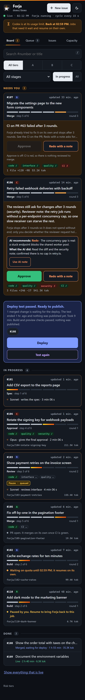

<picture>
  <source media="(prefers-color-scheme: dark)" srcset="docs/logo-dark.svg">
  <source media="(prefers-color-scheme: light)" srcset="docs/logo-light.svg">
  
</picture>

Forja is a software factory for your GitHub repository. You label an issue, and Forja writes a spec, builds the change in its own git worktree, has a different model review it, opens a pull request, waits for your approval, and merges it. You watch and approve from a local dashboard or from PR comments.

It runs as a Claude Code plugin with a small Node 22 engine and no npm dependencies.

## How it works

```
 issue labeled "forja"
   |
   v
 spec --> build --> review --> approve --> pr --> owner approves --> merged --> deployed
          (own      (code, ui,   (approver     (PR     (/approve or     (optional
          worktree, ponytail,    agent)        opened)  dashboard)       deploy step)
          model     security,
          ladder)   custom;
                    a different
                    model than
                    the builder)

 tier with approval "auto":  pr --> merged (when CI is green)
 "redo" loops back to build (up to limits.rounds); stuck jobs go to needs-you
```

Each issue is sorted into a risk tier first. The tier decides which reviews run and who must approve. A tier with `approval: "auto"` merges itself once CI is green, except when the diff touches a protected path (see the safety model), which always waits for you; other tiers wait for your approval. A tier can also limit which paths a change may touch.

Two of the reviewers have names worth knowing:

- **ponytail** is the code-quality review: is the logic right, is it safe, does it hold under real load, is risky code tested, and is every line needed.
- **goldfish** is a blind check of the spec before any code is built. A different model sees only the spec and the repo, not the issue thread, and tries to break the spec: missed cases, wrong files, criteria that cannot be checked.

## Install

In Claude Code, inside any git repository with a GitHub remote:

```
/plugin marketplace add jvitorbarros15/forja
/plugin install forja@forja
/forja:setup
```

`/forja:setup` detects what is installed, asks before turning on optional vendors, and writes `.forja/config.json`. Commit that file and merge it to your default branch, then start the engine. The runner reads its config only from the merged branch: `/forja:start` refuses to run, and `/forja:doctor` warns, until `.forja/config.json` is on the default branch.

```
/forja:start
```

`/forja:doctor` checks the setup. `/forja:status` and `/forja:stop` show and stop the running engine.

Forja works on Windows, macOS and Linux.

## Requirements

Required:

- Node.js 22 or newer
- git
- GitHub CLI (`gh`), authenticated with `gh auth login`
- Claude Code with the `claude` CLI on your PATH

Optional:

- `codex` or `gemini` CLIs, for reviews and builds by other vendors. `agy` (Antigravity CLI, Gemini models) is an option used by the Clareia example only
- Ollama, for local triage
- Playwright with Chromium, for UI screenshots and the `ui` review

Vendors are off until you enable them in `.forja/config.json`. Forja works with Claude alone.

Model chains are lists like `["claude:sonnet", "codex:sol"]`. The builder, the reviewers and goldfish accept any enabled vendor. The spec, approver and advisor roles must be `claude:*` entries: they run as restricted Claude agents with tool allowlists (they read files and may run only a short list of commands, with no network), and no other vendor's CLI can enforce that.

## Safety model

- **Owner approval by default.** Every tier starts with `approval: "owner"`. A person in `approvers` must approve each change, and only logins in that list can label issues or run `/approve` and `/redo`.
- **Auto approval is opt-in and path-bound.** `approval: "auto"` or `autoDeploy: true` is accepted only on a tier that lists `paths`. A build that touches a file outside those paths fails.
- **Protected paths.** `.forja/**`, `.github/workflows/**` and `.claude/**` cannot be edited by the builder. Any diff that touches them needs owner approval, whatever its tier.
- **Check commands run code the builder wrote.** `checks.install`, `typecheck`, `test` and `build`, the allowed test commands of the agents and `ui.serve` and `ui.verify` all run in a job's worktree with your user rights, your environment and your `gh` token, and they execute what the builder just wrote (tests, scripts, install hooks). Forja cannot sandbox that. Run it in a VM, a container or a separate OS account, and give `gh` a token scoped to this one repository (a fine-grained token with only contents, pull requests and issues).
- **Your working copy is never touched.** Forja works only in its own worktrees, `<worktreeRoot>/forja-main` and `<worktreeRoot>/forja-<issue>`.
- **Merged config only.** Forja reads `.forja/config.json` and agent overrides from the merged `forja-main` worktree. A change takes effect after you merge it, never from an open branch. `forja-main` is Forja's own: before every fast-forward and every runner cycle (except while a deploy runs) anything changed or left in it is discarded (`git reset --hard`, `git clean -fd`, `node_modules` kept), so keep no work there.
- **Privacy rules.** `privacy.denyRead` is enforced for Claude agents as a read-deny rule. External vendors cannot be restricted that way, so the same patterns are stated in their prompts. `privacy.promptRules` are added to every agent prompt as hard rules.
- **Review by a different model.** Reviews prefer a different vendor from the builder, so one model does not grade its own work.

## Customization

Everything project-specific lives in `.forja/config.json`: repository, approvers, check commands, tiers, review matrix, model chains, vendors, privacy rules, commit style and language. Two starting points are in [`examples/`](examples/):

- [`examples/minimal.config.json`](examples/minimal.config.json): repository and approvers only. Everything else comes from the defaults.
- [`examples/clareia.config.json`](examples/clareia.config.json): a full real-world setup with three tiers, custom checks, a custom data reviewer and privacy rules.

The Clareia example is a real-world config, not a template. It expects `.forja/agents/review-data.md` in the repo, and it uses `{project}` in check commands for data kept outside git (the `data/private` folders are never in a worktree).

The skill that documents every key, with examples for tiers, chains, reviewers, overrides and checks, is [`skills/forja/SKILL.md`](skills/forja/SKILL.md).

## Dashboard

The local dashboard shows each job, the stage it is in, its reviews and the buttons to approve, redo or deploy.

Desktop, 1440 px wide, light theme:


Phone, 390 px wide, dark theme:



## Development

    npm test

Tests use `node:test` and need no install step.

## License

Forja is released under the [MIT License](LICENSE).

Bundled skills keep their own licenses. See [THIRD_PARTY.md](THIRD_PARTY.md).
